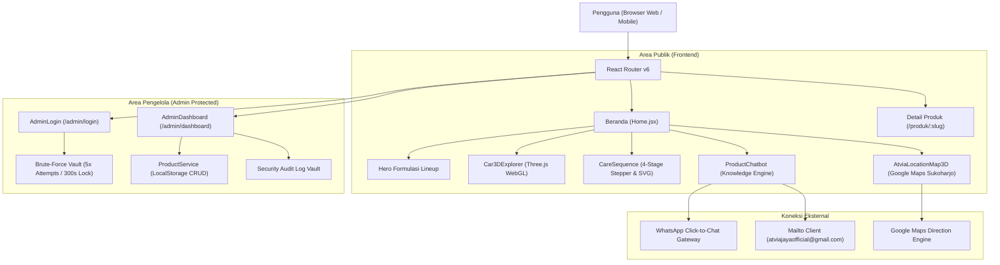

# BUKU PANDUAN SISTEM & PENGGUNA (MASTER MANUAL)
## Platform Digital Company Profile & Konfigurator 3D CV ATVIA JAYA
**Dokumen Resmi Standar Rekayasa Perangkat Lunak & Operasional Sistem**  
*Versi Sistem: 2.4.0 (Enterprise Production Build) • Standar Desain: Swiss-Grid & High-Precision Automotive Engineering*

---

## Lembar Informasi Sistem

| Parameter | Keterangan Teknis |
|:---|:---|
| **Nama Entitas Bisnis** | CV ATVIA JAYA |
| **Bidang Usaha** | Formulasi Perawatan Kendaraan, Auto Detailing & Kebersihan Ruang |
| **Lokasi Fasilitas & Workshop** | Purbayan, Kec. Baki, Kabupaten Sukoharjo, Jawa Tengah 57556 |
| **Kontak Email Resmi** | `atviajayaofficial@gmail.com` (Terhubung format `mailto:`) |
| **WhatsApp Hotline Resmi** | `+62 857-0047-0046` (WhatsApp Click-to-Chat Gateway) |
| **Tumpukan Teknologi (Tech Stack)** | React 18, Vite 5, Three.js WebGL (`@react-three/fiber`, `@react-three/drei`), Lucide React SVG, LocalStorage Persistent Vault |
| **Standar UI/UX** | Swiss-Grid Layout, Zero-Emoji Technical UI, Palet Struktural Abu-abu Netral (`#F8FAFC`, `#0F172A`) & Aksen Merah Solid ATVIA (`#DC2626`) |

---

## Daftar Isi Panduan

1. [Bab I: Gambaran Umum & Arsitektur Teknologi Platform](#bab-i-gambaran-umum--arsitektur-teknologi-platform)
2. [Bab II: Panduan Pengunjung — Beranda & Katalog Formulasi](#bab-ii-panduan-pengunjung--beranda--katalog-formulasi)
3. [Bab III: Panduan Pengunjung — Eksplorasi Mobil 3D & Urutan Perawatan](#bab-iii-panduan-pengunjung--eksplorasi-mobil-3d--urutan-perawatan)
4. [Bab IV: Panduan Spesifikasi Laboratorium & Formulasi Produk](#bab-iv-panduan-spesifikasi-laboratorium--formulasi-produk)
5. [Bab V: Panduan Layanan Interaktif — Chatbot AI & Peta Fasilitas](#bab-v-panduan-layanan-interaktif--chatbot-ai--peta-fasilitas)
6. [Bab VI: Panduan Administrator — Portal Keamanan & Proteksi Brute-Force](#bab-vi-panduan-administrator--portal-keamanan--proteksi-brute-force)
7. [Bab VII: Panduan Administrator — Dashboard Manajemen Inventaris & Hapus Produk](#bab-vii-panduan-administrator--dashboard-manajemen-inventaris--hapus-produk)
8. [Bab VIII: Prosedur Pemeliharaan, Konfigurasi Lingkungan & Standar Deployment](#bab-viii-prosedur-pemeliharaan-konfigurasi-lingkungan--standar-deployment)

---

## Bab I: Gambaran Umum & Arsitektur Teknologi Platform

Platform digital **CV ATVIA JAYA** dirancang untuk menghadirkan profil manufaktur perawatan kendaraan modern yang memadukan kredibilitas teknis laboratorium dengan pengalaman eksplorasi interaktif 3D yang ringan dan responsif di seluruh perangkat (*desktop*, tablet, dan ponsel pintar).



### Karakteristik & Fondasi Rekayasa Sistem:
1. **Performa Tinggi Tanpa Beban Berat (*Lightweight 3D*):** Model 3D mobil sport (`ferrari.glb`) dioptimalkan menggunakan kompresi geometri **Draco**, pencahayaan ambient efisien, dan pembatasan draw-call sehingga berjalan mulus 60 FPS pada perangkat seluler.
2. **Prinsip Desain Anti-AI Slop:** Seluruh antarmuka mengacu pada filosofi instrumen teknis industri otomotif presisi:
   - Tidak menggunakan emoji pada komponen antarmuka pengguna; seluruh indikator visual menggunakan ikon vektor geometris **Lucide React** dengan ketebalan garis seragam (*stroke-width: 1.75px–2px*).
   - Menghindari gradasi neon klise dan bayangan blur berlebihan (*no cheesy floating glows*); mengedepankan border tipis 1px (`#E2E8F0`), latar belakang putih bersih (`#FFFFFF`) / abu-abu teknis (`#F8FAFC`), dan aksen merah solid ATVIA (`#DC2626`).
3. **Penyimpanan Lokal Persisten (*Persistent State*):** Modul katalog produk admin dan audit log keamanan beroperasi secara mandiri memanfaatkan `localStorage` browser yang terisolasi dengan sinkronisasi event reaktif instan.

---

## Bab II: Panduan Pengunjung — Beranda & Katalog Formulasi


*Gambar 1.1 Antarmuka Halaman Beranda (Home) dan Komposisi Katalog Produk CV ATVIA JAYA (Resolusi Tinggi 300 DPI)*

### Bedah Komponen Antarmuka Beranda:
* **[1] Global Technical Navbar:**  
  Bilah navigasi utama yang ramping dan mengambang (*sticky header*). Menyediakan tautan cepat ke seksi **Produk**, **Urutan Perawatan**, **Tanya Jawab**, **Tentang**, dan **Kontak**. Dilengkapi tombol pengalih tema gelap/terang (**ThemeToggle**) dan tombol WhatsApp resmi.
* **[2] Headline Nilai Formulasi:**  
  Menyajikan identitas nilai ATVIA: *"Dari bersih hingga terlindungi. Perawatan kendaraan yang tepat, dari awal hingga akhir."* Dilengkapi tombol pintas *"Jelajahi Produk"* dan *"Konsultasi dengan ATVIA"*.
* **[3] Visual Laboratorium & Kemasan Botol:**  
  Menampilkan potret kemasan botol resmi dengan latar bengkel perawatan presisi di Sukoharjo, menegaskan bahwa produk ATVIA adalah formula riil yang diuji di lapangan.
* **[4] 5 Formula Lineup Grid:**  
  Daftar 5 produk inti perawatan kendaraan ATVIA:
  1. `Waterspot Cleaner` — Pembersih kerak mineral dan jamur air pada kaca/bodi.
  2. `Interior Guard` — Formula pembersih, perlindungan UV, dan sanitasi kabin kendaraan.
  3. `Action Black Dressing` — Restorasi trim plastik kasar, karet talang, dan mudguard yang memutih.
  4. `Tire Shine Protection` — Semir ban efek basah (*deep wet-look*) dengan formula tahan cipratan air.
  5. `Advance Coating` — Lapisan polimer silika SiO2 dengan efek hidrofobik daun talas intensif.
* **[5] WhatsApp Direct CTA:**  
  Tombol aksi langsung di sudut kanan atas yang membuka percakapan WhatsApp resmi dengan pesan salam terformat otomatis.

---

## Bab III: Panduan Pengunjung — Eksplorasi Mobil 3D & Urutan Perawatan


*Gambar 2.1 Modul Interaktif Eksplorasi Mobil 3D WebGL dan Urutan Perawatan Terarah 4 Tahap (Resolusi Tinggi 300 DPI)*

### 1. Modul Interaktif Eksplorasi Mobil 3D (WebGL Canvas)
Pengunjung dapat memeriksa bagian fisik kendaraan secara langsung di dalam peramban web:
* **Kontrol Kamera Orbit:** Klik dan geser mouse (atau usap layar ponsel) untuk memutar kendaraan secara bebas 360 derajat. Gunakan *scroll wheel* atau cubit layar (*pinch*) untuk memperbesar (*zoom*) detail bodi mobil.
* **Titik Akses Interaktif (Hotspots):** Terdapat 4 penanda hotspot visual pada bodi kendaraan:
  - **Hotspot Kaca Depan & Samping:** Merekomendasikan formula `Waterspot Cleaner`.
  - **Hotspot Bodi Cat Utama:** Merekomendasikan formula `Advance Coating`.
  - **Hotspot Dinding Ban & Velg:** Merekomendasikan formula `Tire Shine Protection`.
  - **Hotspot Trim Plastik Kasar & Fender:** Merekomendasikan formula `Action Black Dressing`.

### 2. Modul Urutan Perawatan Terarah (4-Stage Pipeline Stepper)
Sistem memandu pengunjung menerapkan perawatan kendaraan dalam urutan metodologi salon detailing profesional:

| Tahap | Nama Tahapan | Fokus Pekerjaan Substrat | Produk Terkait ATVIA |
|:---:|:---|:---|:---|
| **1** | **Bersihkan & Dekontaminasi** | Kaca depan, kaca samping, emblem bodi, sela-sela panel yang berkerak mineral. | `Waterspot Cleaner 250ml` |
| **2** | **Restorasi Trim & Dinding Ban** | Plastik kulit jeruk (unpainted trim), talang wiper, spakbor, dan dinding ban. | `Action Black Dressing` & `Tire Shine Protection` |
| **3** | **Proteksi Kilap Cat Eksterior** | Seluruh panel cat bodi (kap mesin, atap, pintu) untuk mengunci kilap dan hidrofobik. | `Advance Coating 250ml` |
| **4** | **Perawatan Kabin Interior** | Dasbor, konsol tengah, panel pintu, lingkar kemudi, dan jok berbahan sintetis/kulit. | `Interior Guard 250ml` |

* **Skematik Zona Aktif (2D Technical Blueprint):**  
  Pada kartu detail tahapan aktif, skematik 2D siluet kendaraan secara dinamis menyalakan lampu sorot merah solid (`#DC2626`) pada bagian mobil yang relevan, memudahkan pemilik kendaraan memahami zona kerja tanpa perlu membaca teks yang rumit.

---

## Bab IV: Panduan Spesifikasi Laboratorium & Formulasi Produk


*Gambar 3.1 Antarmuka Spesifikasi Laboratorium, SOP Aplikasi, dan Data Kimiawi Produk (Resolusi Tinggi 300 DPI)*

Setiap produk ATVIA memiliki halaman spesifikasi komprehensif (`/produk/:slug`) yang membedah formula kimia secara transparan:

### 1. Parameter Kimia Laboratorium (Lab Specs Grid)
* **Tingkat pH Formula:** Menampilkan keasaman/kebasaan produk (contoh: *pH Netral 6.8–7.2* pada Advance Coating agar tidak merusak pernis bening / *clearcoat*).
* **Waktu Curing:** Durasi waktu pengeringan lapisan polimer sebelum siap diseka bersih menggunakan lap microfiber (*buffing*).
* **Estimasi Yield:** Jumlah kendaraan yang dapat diproses oleh 1 botol kemasan (misal: 1 botol 250ml cukup untuk 4–6 unit mobil tipe MPV/Sedan).
* **Daya Tahan Lapisan:** Ketahanan proteksi terhadap cuaca tropis, cuci mobil berkala, dan paparan sinar ultraviolet.

### 2. Standar Operasional Prosedur (SOP) Lapangan
Disusun dalam 4 tahapan ringkas yang mudah dipraktikkan:
1. **Persiapan (Preparation):** Pencucian bodi dan dekontaminasi residu debu/minyak.
2. **Aplikasi (Application):** Penyemprotan merata atau pengolesan dengan busa aplikator khusus.
3. **Perataan (Leveling):** Gerakan silang (*cross-hatch pattern*) per panel 50 x 50 cm.
4. **Penyekaan & Pengeringan (Buffing & Cure):** Pembersihan residu menggunakan kain microfiber bersih.

### 3. Protokol Keselamatan Kerja & Pasokan Grosir B2B
* Menyajikan petunjuk penggunaan Alat Pelindung Diri (APD: sarung tangan nitril dan kacamata pelindung jika diperlukan).
* Opsi konfigurasi pemesanan partai besar (jeriken industri 5 Liter) khusus bengkel resmi, salon detailing, dan penyedia jasa *car wash*.

---

## Bab V: Panduan Layanan Interaktif — Chatbot AI & Peta Fasilitas


*Gambar 4.1 Asisten AI Laboratorium (Chatbot) dan Integrasi Peta Workshop Google Maps (Resolusi Tinggi 300 DPI)*

### 1. Asisten Laboratorium ATVIA (`ProductChatbot.jsx`)
Asisten cerdas berbasis *Knowledge Engine* terintegrasi langsung di beranda:
* **Isolasi Scroll Internal (*No Page Jumping*):**  
  Pengiriman pesan melalui penekanan tombol *Enter* atau tombol kirim sepenuhnya terisolasi di dalam kotak percakapan, sehingga tidak menyebabkan jendela peramban meloncat ke bawah atau mengganggu posisi baca pengguna.
* **Cakupan Pengetahuan Teknis:**
  - Diagnosa masalah perawatan (jamur kaca, kerak air, baret halus, trim plastik pudar, interior kotor).
  - Informasi jam operasional workshop Sukoharjo (`Senin – Sabtu, 08.00 – 17.00 WIB`).
  - Informasi rute dan navigasi Google Maps.
  - Penawaran kerja sama distributor, reseller, dan kemitraan B2B.
* **Tombol Aksi Tautan Mandiri:**
  Jika pengunjung menanyakan email atau WhatsApp, asisten otomatis menyajikan tombol berikon:
  - **`[ Kirim Email ke atviajayaofficial@gmail.com ]`** (Membuka aplikasi email secara langsung).
  - **`[ Chat WhatsApp (+62 857-0047-0046) ]`** (Menghubungkan langsung ke CS manusia).
  - **`[ Petunjuk Rute Maps ]`** (Membuka aplikasi peta di perangkat pengguna).

### 2. Seksi Peta Fasilitas & Pusat Distribusi (`AtviaLocationMap3D.jsx`)
* **Integrasi Murni Google Maps:** Menampilkan peta jalan (*Roadmap*) dan citra satelit (*Satellite*) resmi dari koordinat Atvia Jaya di Purbayan, Kec. Baki, Kabupaten Sukoharjo.
* **Panel Spesifikasi Operasional:**
  - Wilayah Operasional: *Purbayan, Kec. Baki, Kab. Sukoharjo, Jawa Tengah 57556*.
  - Jam Operasional: *Senin – Sabtu: 08.00 – 17.00 WIB*.
  - Layanan Logistik: *Pengiriman Reguler & Kargo B2B Nasional*.
  - Email Resmi Koordinasi: **`atviajayaofficial@gmail.com`**.
* **Tombol Navigasi Cepat:** Tombol *"Petunjuk Arah di Google Maps"* yang langsung membuka rute GPS kendaraan menuju lokasi bengkel.

---

## Bab VI: Panduan Administrator — Portal Keamanan & Proteksi Brute-Force


*Gambar 5.1 Portal Autentikasi Keamanan, Dashboard Inventaris, dan Modal Konfirmasi Hapus Produk (Resolusi Tinggi 300 DPI)*

Akses ke area pengelolaan sistem diproteksi dengan mekanisme pertahanan berlapis pada halaman `/admin/login`:

### 1. Mekanisme Proteksi Brute-Force (Brute-Force Vault)
Untuk mencegah serangan tebakan kata sandi otomatis (*automated password guessing*):
* **Batas Percobaan Gagal:** Administrator hanya diperbolehkan mencoba memasukkan passcode sebanyak **5 kali**.
* **Penguncian Akses Otomatis (*Lockout Penality*):**  
  Jika gagal 5 kali berturut-turut, sistem langsung mengunci formulir login selama **300 detik (5 menit)**.
* **Indikator Hitung Mundur (*Countdown Timer*):**  
  Selama masa penalti, kotak input passcode dinonaktifkan (*disabled*) dan waktu hitung mundur ditampilkan secara *real-time* dalam format `Menit:Detik`.
* **Pencatatan Audit Keamanan:** Setiap upaya login yang gagal maupun penguncian akun dicatat secara permanen pada log audit dengan cap waktu (*timestamp*) presisi.

### 2. Sesi Terenkripsi & Masa Kedaluwarsa Otomatis
* Setelah passcode benar dimasukkan, sistem membuat token sesi terenkripsi dengan durasi masa aktif **2 jam**.
* Jika tidak terdapat aktivitas setelah 2 jam, sesi akan otomatis kedaluwarsa dan administrator wajib melakukan login ulang untuk menjaga keamanan data inventaris.

---

## Bab VII: Panduan Administrator — Dashboard Manajemen Inventaris & Hapus Produk

Halaman `/admin/dashboard` memberikan wewenang penuh kepada administrator untuk mengelola formulasi produk yang tayang pada website publik:

### 1. Panel Statistik Inventaris Real-Time
Pada bagian atas dashboard, terdapat 4 metrik kartu pemantau:
* **Total Formula:** Jumlah seluruh produk yang terdaftar dalam basis data sistem.
* **Published Live:** Jumlah produk yang sedang aktif tampil pada katalog publik dan dapat diakses pengunjung.
* **Draf Tersimpan:** Formulasi produk yang disimpan sementara untuk peninjauan internal sebelum dirilis.
* **Log Audit Keamanan:** Akumulasi riwayat aktivitas administratif yang terekam.

### 2. Penambahan & Pembaruan Formula Produk
Administrator dapat menambahkan produk baru melalui formulir terstruktur:
* **Informasi Dasar:** Nama produk, slug URL, kategori kimiawi, volume botol (ml), dan estimasi harga.
* **Unggah Foto Produk Fleksibel:**
  - **Opsi A (File Uploader Asli):** Mengunggah file foto dari perangkat komputer; sistem secara otomatis mengonversi gambar ke format data aman (Base64) tanpa memerlukan server penyimpanan pihak ketiga.
  - **Opsi B (5 Preset Botol Resmi ATVIA):** Memilih salah satu dari 5 foto kemasan botol studio resmi yang telah disediakan sistem.
* **Kontrol Status Publikasi:** Memilih apakah formula langsung diterbitkan (*Published*) atau disimpan sebagai *Draf*.

### 3. Prosedur Aman Penghapusan Produk Published
Untuk mencegah terjadinya salah klik (*accidental deletion*) yang dapat merusak tautan produk di publik:
1. Administrator mencari produk pada tabel katalog lalu mengklik tombol **Hapus** (ikon tempat sampah merah).
2. Sistem memunculkan **Modal Konfirmasi Khusus Penghapusan Produk Published**.
3. Modal tersebut menampilkan foto thumbnail produk, nama lengkap formula, volume, dan badge tegas berbunyi: `STATUS: PUBLISHED (LIVE)`.
4. Sistem memuat peringatan eksplisit: *"Penghapusan akan mencabut produk dari katalog publik dan rekomendasi Chatbot AI seketika."*
5. Tindakan penghapusan hanya dieksekusi jika administrator menekan tombol merah **`Ya, Hapus Produk dari Live`**.
6. Sistem mencabut produk dari penyimpanan lokal, mencatat riwayat ke log audit keamanan (`HAPUS_PRODUK`), dan memperbarui tampilan beranda secara reaktif seketika.

### 4. Log Audit Keamanan Persisten (Audit Trail)
Setiap tindakan administratif dicatat secara transparan pada tabel audit log:
* `LOGIN_BERHASIL` — Waktu masuk administrator.
* `LOGIN_GAGAL` / `AKUN_TERKUNCI` — Catatan insiden keamanan.
* `TAMBAH_PRODUK` — Penambahan data formula baru ke sistem.
* `HAPUS_PRODUK` — Pencabutan produk dari status live atau draf.
* `GANTI_PASSCODE` — Riwayat pembaruan kredensial keamanan.

---

## Bab VIII: Prosedur Pemeliharaan, Konfigurasi Lingkungan & Standar Deployment

### 1. Konfigurasi Variabel Lingkungan (`.env`)
Seluruh parameter kontak dan konfigurasi dinamis disimpan pada file `.env` di direktori utama proyek:

```env
# Konfigurasi Kontak WhatsApp Resmi ATVIA
# Format: Nomor internasional tanpa tanda + (Contoh: 6285700470046)
VITE_WHATSAPP_NUMBER=6285700470046

# Kontak Email Komunikasi Resmi ATVIA
VITE_EMAIL=atviajayaofficial@gmail.com

# Wilayah Operasional & Workshop
VITE_LOCATION=Purbayan, Baki, Sukoharjo, Jawa Tengah
```

### 2. Perintah Pemeliharaan & Pengujian Kode
Di dalam direktori kerja `D:\CompanyProfile\frontend-atvia`, jalankan perintah berikut menggunakan terminal:

* **Menjalankan Server Pengembangan Lokal:**
  ```bash
  npm run dev
  ```
  Aplikasi akan berjalan pada alamat lokal `http://localhost:5173/`.

* **Pemeriksaan Kualitas Kode (Linting):**
  ```bash
  npm run lint
  ```
  Memverifikasi keselarasan sintaksis ESLint untuk memastikan tidak ada kesalahan variabel atau import yang rusak.

* **Kompilasi Siap Produksi (Production Build):**
  ```bash
  npm run build
  ```
  Menghasilkan bundel teroptimasi dan terminifikasi di dalam folder `dist/` yang siap dideploy ke server hosting (cPanel, Vercel, Netlify, atau Nginx).

---

## Lampiran: Daftar File Gambar Resolusi Tinggi untuk Cetak / Laporan

Seluruh gambar yang digunakan di dalam buku panduan ini telah disimpan pada direktori kerja komputer Anda dalam format PNG beresolusi tinggi (300 DPI) dan dapat langsung disalin ke dokumen laporan Microsoft Word atau Google Docs:

1. **[panduan_01_beranda_katalog.png](file:///C:/Users/acer/.gemini/antigravity/brain/872e26f3-2561-4241-957f-a39f8325063c/panduan_01_beranda_katalog.png)**  
   *Gambar 1.1 Antarmuka Halaman Beranda (Home) dan Komposisi Katalog Produk CV ATVIA JAYA*
2. **[panduan_02_eksplorasi_3d_perawatan.png](file:///C:/Users/acer/.gemini/antigravity/brain/872e26f3-2561-4241-957f-a39f8325063c/panduan_02_eksplorasi_3d_perawatan.png)**  
   *Gambar 2.1 Modul Interaktif Eksplorasi Mobil 3D dan Urutan Perawatan Terarah 4 Tahap*
3. **[panduan_03_detail_produk_lab.png](file:///C:/Users/acer/.gemini/antigravity/brain/872e26f3-2561-4241-957f-a39f8325063c/panduan_03_detail_produk_lab.png)**  
   *Gambar 3.1 Antarmuka Spesifikasi Laboratorium, SOP Aplikasi, dan Data Kimiawi Produk*
4. **[panduan_04_asisten_ai_peta.png](file:///C:/Users/acer/.gemini/antigravity/brain/872e26f3-2561-4241-957f-a39f8325063c/panduan_04_asisten_ai_peta.png)**  
   *Gambar 4.1 Asisten AI Laboratorium (Chatbot) dan Integrasi Peta Workshop Google Maps*
5. **[panduan_05_portal_admin_crud.png](file:///C:/Users/acer/.gemini/antigravity/brain/872e26f3-2561-4241-957f-a39f8325063c/panduan_05_portal_admin_crud.png)**  
   *Gambar 5.1 Portal Autentikasi Keamanan, Dashboard Inventaris, dan Modal Konfirmasi Hapus*

---
*© 2026 CV ATVIA JAYA. Seluruh Hak Cipta Dilindungi. Disusun berdasarkan implementasi riil arsitektur sistem.*
